  

  

Hola, soy <b>Iñaky</b>. Desarrollador Full Stack en formación, siempre dispuesto a aprender de más cosas.

### 
<b>// SOBRE_MI</b>

  

### 
<b>// STACK</b>

### 
Lenguajes

  
  
  
  
  

### 
Frameworks

  

### 
Bases de datos

  

### 
Herramientas

  
  

<!--

<!--
### 
<b>// PROYECTOS</b>

  
 <!-- 

### 
<b>// ESTADISTICAS</b>

  

  

  

  

### 
<b>// CONTACTO</b>

  
  
  

